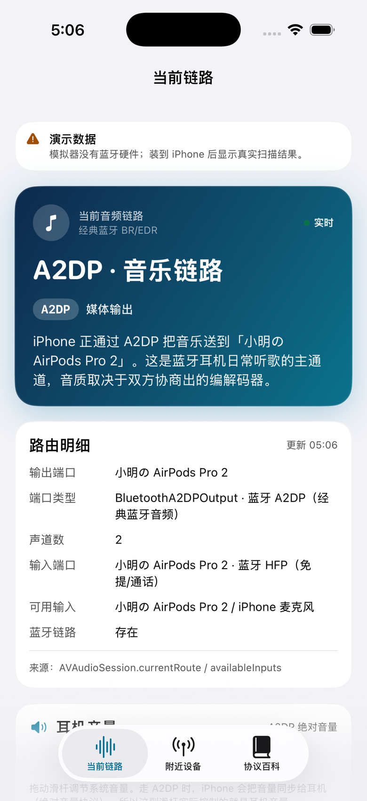
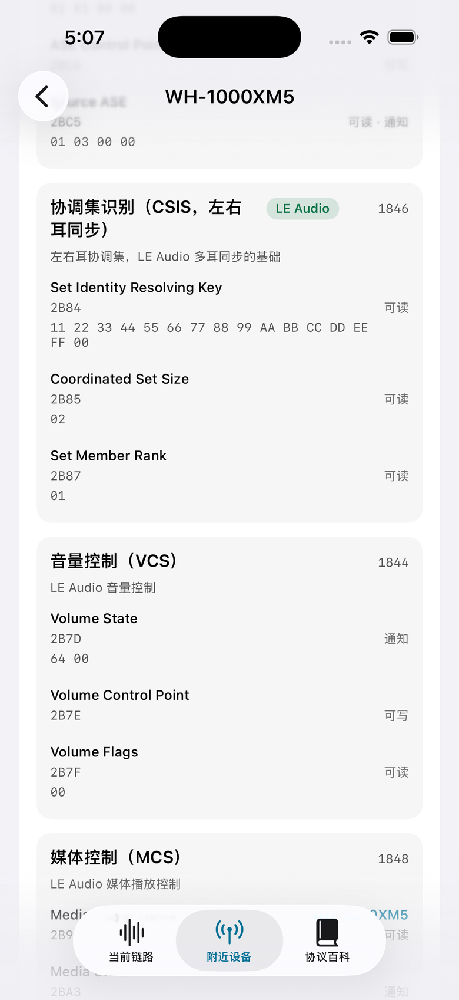

# 耳机协议观察器 · BT Inspector

一个 iPhone 小工具：**看你的蓝牙耳机到底在用哪个蓝牙协议**。

插上耳机 → 打开 App →「当前链路」直接告诉你系统正在用 A2DP 听歌、HFP 通话，还是 LE Audio；
「附近设备」再往下挖 BLE 层的 GATT 服务：设备信息、电量、有没有 LE Audio（LC3）能力，
Apple 耳机还能读出型号、左右耳和充电盒电量。

**下载**：[最新未签名 IPA](https://github.com/Tokeiyo929/bluetooth-earphone-inspector/releases/latest)
（`bt-inspector-unsigned.ipa`，用 Sideloadly / SideStore 自签安装）。



## 它回答的五个问题

| 问题 | 在哪看 | 依据 |
| --- | --- | --- |
| 现在听歌走的是 A2DP 还是 HFP？ | 当前链路 | `AVAudioSession.currentRoute` 的端口类型 |
| 我的耳机支持 LE Audio 吗？ | 附近设备 → 详情 | GATT 里是否有 PACS(0x1850) / ASCS(0x184E) / CSIS(0x1846) |
| AirPods 什么型号、还剩多少电？ | 附近设备 → 详情 | Apple 私有邻近广播（厂商 ID 0x004C） |
| 用的什么芯片 / 方案商？ | 附近设备 → 详情 → 芯片与版本线索 | GATT 设备信息 + PnP ID + 广播厂商 ID + 料号字符串 |
| 商家说的蓝牙 5.2 能验证吗？ | 附近设备 → 详情 → 蓝牙版本 | LE Audio 服务是 5.2 唯一可验证的能力 |

## 三个页签

- **当前链路**：结论卡 + 路由明细 + 音量滑杆 + 判定依据。端口类型是 `BluetoothA2DPOutput`、
  `BluetoothHFP`、`BluetoothLE` 时分别判为 A2DP、HFP、LE Audio。同时报告蓝牙麦克风是否在线。
  音量滑杆走系统输出音量，A2DP 绝对音量会把它同步到耳机。
- **附近设备**：BLE 扫描列表（名称、RSSI、电量、LE Audio 标记），点进去看芯片线索、
  GATT 服务与特征值；设备若暴露标准 MCS 控制点，还能发播放/暂停/切歌。
  已通过系统保持 BLE 链路的设备会单独列在「系统已连接」。
- **协议百科**：A2DP / HFP / AVRCP / HSP / SPP / BLE GATT / LE Audio 都是干什么的，
  以及 SBC / AAC / aptX / LDAC / LC3 的区别。

## 能通过蓝牙控制耳机吗

分三层，能力完全不同：

1. **音量**：能。`MPVolumeView` 改系统输出音量，A2DP 的绝对音量会把数值同步给耳机。
2. **播放/暂停/切歌**：如果耳机暴露蓝牙标准的 Media Control Service（0x1848 / 0x1849）
   与控制点 0x2BA4，App 可以直接发指令（详情页「播放控制」）。普通经典蓝牙耳机走 AVRCP，
   指令由系统和耳机按键处理，第三方 App 没有「发送 AVRCP 指令」的公开 API。
3. **降噪/通透/EQ/固件升级**：属于厂商私有 BLE 协议（Sony、Bose、JBL 各家不一样），
   iOS 没有统一 API，只能用厂商自己的 App（如 Sony Headphones Connect）。

App 在详情页会直接标明这台设备暴露了哪些控制服务，没暴露的不会假装能控制。

## 能看到芯片型号吗

不能直接读裸片型号 —— iOS 没有这样的 API。App 把能拿到的线索摊开：

- GATT 设备信息（0x180A）：制造商、型号、固件、硬件版本；
- PnP ID（0x2A23）：厂商 ID 能追到 Bluetooth SIG / USB-IF 注册公司；
- 广播厂商 ID（manufacturer data 前两字节）；
- 型号/固件字符串里的料号：`BES2500` → 恒玄、`AB1562` → 络达、`QCC3040` → 高通、
  `RTL8763` → 瑞昱、`BK3298` → 博通集成、`AC695` → 杰理 等；
- 厂商私有 128-bit 服务。

结论分「品牌」「方案商」「芯片系列」三档，并标注置信度。品牌名不会被硬说成芯片厂商。



## 蓝牙 5.2 能验证吗

系统界面和第三方 App 都读不到协商后的核心规格版本。唯一可验证的 5.2 能力是 **LE Audio**：

- 设备暴露 PACS / ASCS / CSIS 等服务 → 判定「至少 5.2」，这是硬证据；
- 没有 LE Audio → 写「无法验证」，并说明这不等于低于 5.2：
  很多 5.2 耳机只在经典蓝牙上跑 A2DP，LE Audio 只是没被用起来。

## 判定原理（以及 iOS 的边界）

1. **音频协议只能从音频会话判断。** iOS 不向第三方 App 公开 A2DP 编解码协商结果，
   所以本 App 不会假装知道「你正在用 AAC 还是 SBC」，而是明确写出 iPhone 的默认策略。
2. **CoreBluetooth 只看得见 BLE。** 只用经典蓝牙的廉价耳机不会出现在扫描列表里，
   但它们的 A2DP/HFP 链路仍会被「当前链路」抓到。
3. **GATT 服务可能读不全。** 有些耳机把 BLE 会话交给系统独占，第三方 App 连接后
   只能拿到部分服务；这时 LE Audio 能力可能漏判。App 会把这种情况说明白。
4. **Apple 广播是私有格式。** 型号 / 电量解析参考开源项目 LibrePods 对 0x07 邻近报文的拆解；
   新固件改为加密广播时，电量读数可能失真。
5. **芯片与版本只能推断。** 上面的线索能指认方案商，不保证指认裸片；没有 LE Audio 时
   5.2 无法验证，App 会把「没证据」和「不是 5.2」分开写。

App 不上传任何数据，也不需要网络。

## 安装（未签名 IPA）

CI 每次 push 都会产出未签名 IPA，并发布到 Releases：

- 下载 `bt-inspector-unsigned.ipa`
- 用 **Sideloadly** 直接装（免费 Apple ID 自签即可，不需要特殊 entitlements）
- 或 **SideStore / AltStore** 重签安装（打包态显示名为 ASCII `BT Inspector`，中文名走 zh-Hans 本地化）

首次启动会弹「允许使用蓝牙？」，允许后即可扫描。

## 构建与测试

工程用 [XcodeGen](https://github.com/yonaskolb/XcodeGen) 生成，Windows 上不编译，全部由 GitHub Actions 验证。

```bash
cd ios/App
brew install xcodegen
xcodegen generate
open BTInspector.xcodeproj
```

四层验证（对应 `tests/`）：

- **L1 核心回归**：`swiftc` 隔离编译纯逻辑（UUID 规整、Apple 广播解析、路由结论、GATT 解码、
  信号阈值、演示数据），秒级，不依赖模拟器。
- **L2 进程内自测**：`-autoTest` 启动参数，跑同一套核心回归 + 真实 `AVAudioSession` 输出端口检查，
  结果写 `tmp/autotest/`。
- **L3 全页面截图巡访**：`-autoSmoke` 走完 3 个页签 + 2 个设备详情页，每页拍两张
  （首屏 + 滚到底），与 runner 用 `now-<name>` / `ack-<name>` 标记文件握手截图。
- **runner 自检**：`tests/test_simulator_runner.sh` 用假 `xcrun` 覆盖「全部截图成功 / app 报 FAIL /
  app 提前退出」三条路径。

模拟器没有蓝牙硬件，所以巡访用 `-demo` 演示数据；真实扫描需要 iPhone。

## 数据来源与参考

- GATT 服务 / 特征值名称：Bluetooth SIG assigned numbers（`tools/gen_gatt_uuids.py` 生成
  `GATTUUIDs.swift`，共 76 个标准服务、512 个特征值）。
- Apple 邻近广播字段与电量 nibble：开源项目
  [LibrePods](https://github.com/librepods-org/librepods) 的 `BLEManager.kt` 实现。
- 端口分类、HFP/A2DP 关系、LE Audio 服务集合：Bluetooth Core 规范与 Apple AVAudioSession 文档。
- App 图标：`ios/icon/icon.svg`，`render_icon.py` 用 Pillow 栅格化成 1024px 不透明方图。

## 目录

```
ios/App/App/
  Core/                 纯逻辑（可在 macOS 上 swiftc 隔离测试）
  Services/             AVAudioSession / CoreBluetooth / 顶层模型
  Views/                SwiftUI 页面与设计系统
tests/                  L1 入口、runner 与 runner 自检
tools/                  GATT UUID 生成脚本
ios/icon/               图标设计源与栅格化脚本
```
